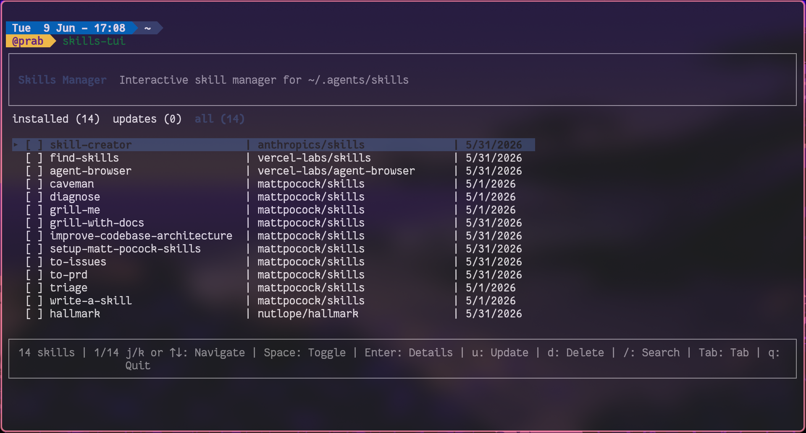

# skills-tui



Interactive terminal UI for managing AI agent skills. Browse, search, multi-select, delete, and update skills — across every agent that keeps skills on disk (`.agents`, Claude, Codex, Cursor, OpenCode, Gemini, and more).

## Install

```bash
curl -fsSL https://raw.githubusercontent.com/ChindanaiNaKub/skills-tui/master/install.sh | sh
```

Installs to `~/.local/share/skills-tui` and drops a `skills-tui` launcher in `~/.local/bin`. Requires **Node.js 18+**.

The launcher **self-updates**: at most once a day it pulls the latest code and swaps in a fresh build in the background, so it never slows down or interrupts a run. Update on demand with `skills-tui --update`, check the version with `skills-tui --version`, or disable auto-update with `SKILLS_TUI_NO_UPDATE=1`. Override paths with `SKILLS_TUI_HOME`, `SKILLS_TUI_BIN`, `SKILLS_TUI_REF`, or `SKILLS_TUI_REPO`.

Nothing is published to the npm registry — the installer clones the repo and builds it locally (dependencies are still fetched with `npm`).

## Usage

```bash
skills-tui
```

### Keys

| Key | Action |
|-----|--------|
| `j` / `↓` | Move down |
| `k` / `↑` | Move up |
| `Space` | Toggle select |
| `a` | Select all / clear selection (in the current view) |
| `Enter` | View skill details (all agent paths shown here) |
| `u` | Update selected skill(s) |
| `d` | Delete selected skill(s) → moves them to the vault |
| `r` | Open the vault to restore deleted skills |
| `/` | Search / filter |
| `Tab` | Switch tab (installed / updates / all) |
| `Esc` | Back / quit |
| `q` | Quit |

Inside the vault: `j`/`k` move, `Space` toggle, `a` all, `Enter` (or `r`) restore, `Esc` close.

## Features

- **Multiple agents, one list** — scans global skill dirs for `.agents`, Claude, Codex, Cursor, OpenCode, Gemini, CommandCode, Crush, Goose, Devin, and project-local variants. Each row shows an **agent badge** (`claude,codex+5`) so you can see where a skill actually lives.
- **Tabs** — Switch between installed, update-available, and all skills
- **Search** — Filter by name, source repo, or plugin
- **Multi-select** — Space to toggle, `a` for all, then bulk update or delete
- **Vault (undoable delete)** — Deleting moves skills to `~/.config/skills-tui/vault` instead of erasing them, so you can purge everything and restore later. Symlinks are recorded and recreated on restore.
- **Scroll windowing** — Handles hundreds of skills without slowdown
- **Details view** — Source repo, install dates, hashes, and every agent path for the skill

## Purging and restoring everything

To clear your context cheaply: press `a` to select all, `d` to delete, `y` to confirm. That vaults every skill. Later press `r`, `a`, `Enter` to restore them all. Nothing is erased in between.

## Custom paths

Auto-detected dirs cover the common agents. For anything else, point at extra dirs (path-delimited, like `PATH`):

```bash
SKILLS_TUI_DIRS="/some/other/skills:$HOME/.mytool/skills" skills-tui
```

`SKILLS_TUI_VAULT` relocates the vault, and `SKILLS_TUI_LOCK` overrides the lock file path.

## How it works

Reads the lock file at `~/.agents/.skill-lock.json` (managed by [`skills`](https://skills.sh)) and scans known agent skill directories on disk. Skills sharing a name are grouped into one row, with all their agent locations tracked. Uses [Ink](https://github.com/vadimdemedes/ink) for the React-based terminal UI.

## Development

```bash
npm run dev        # run from source
npm run selfcheck  # assert-based check of the vault move/restore round trip
```

## Related

- [`skills`](https://skills.sh) — Skill package manager (`npx skills`)


